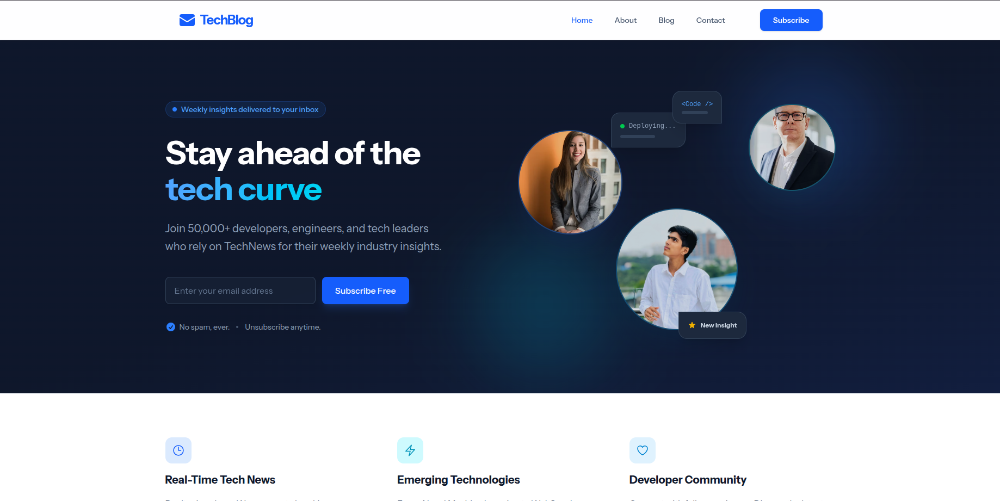
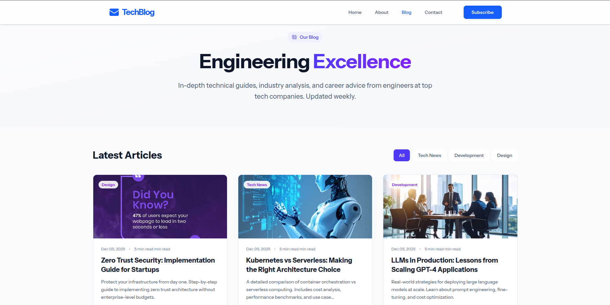
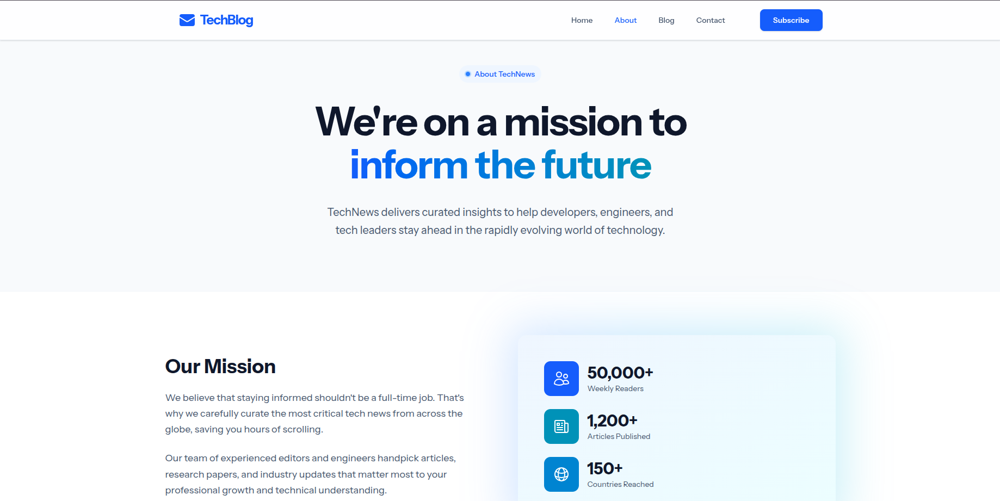
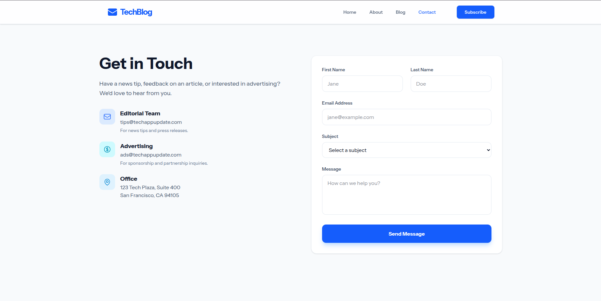
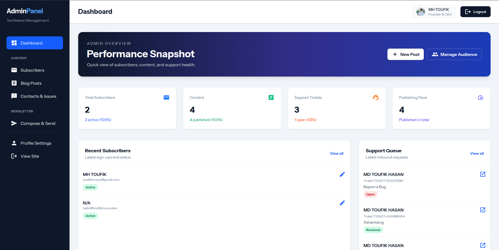
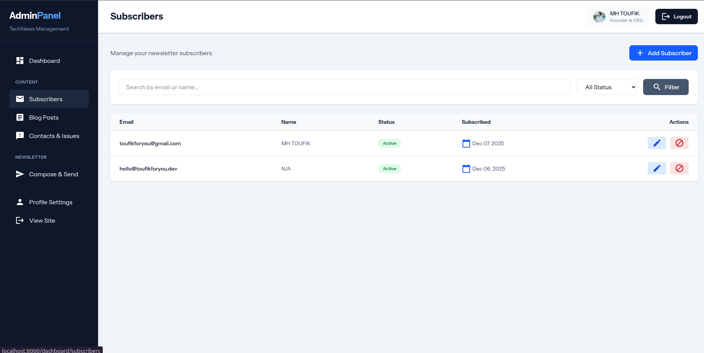
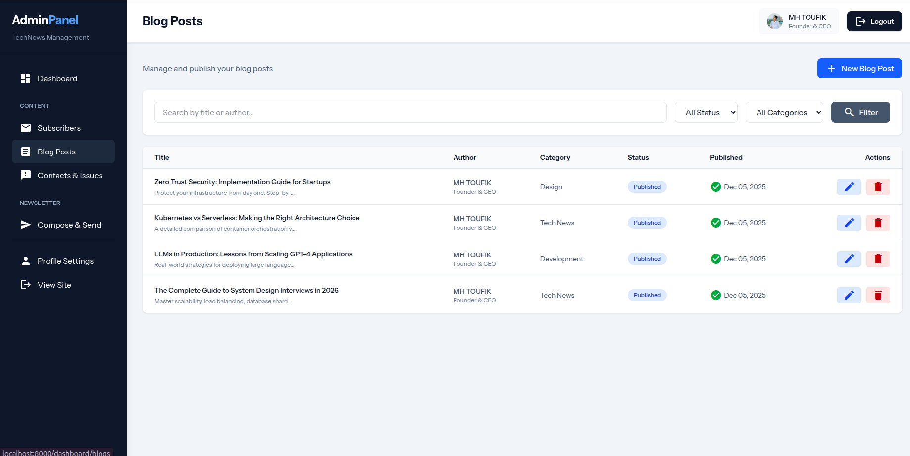
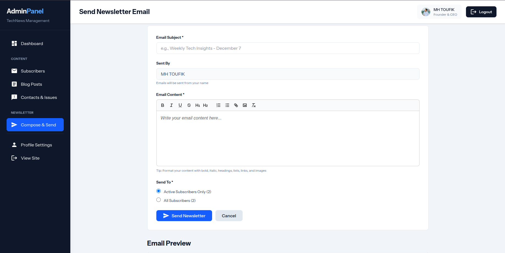

<div align="center">

# TechNews

**A newsletter and blog platform with a proper admin dashboard behind it.**

Write posts, grow a subscriber list, send newsletters in the background, and answer readers, all from one place.

[](https://github.com/toufikforyou/newsletter-platform/actions)
[](https://laravel.com)
[](#requirements)
[](https://tailwindcss.com)
[](#requirements)
[](LICENSE)

**Live:** [techappupdate.com](https://techappupdate.com)

[Screenshots](#screenshots) · [Features](#features) · [Run it locally](#run-it-locally) · [Deploy](#deploying-to-production) · [History](#project-history)

<br />



</div>

---

## Why I built it

Most newsletter tools are either a hosted service you rent, or a blog with a sign-up box bolted on.
I wanted both halves in one app I control: a public site where people read and subscribe, and a dashboard
where I write, send and reply without touching the database.

The part I cared most about is sending. Emails never go out during a web request. They go into a queue, and a
worker sends them in the background, so a newsletter to thousands of people doesn't freeze the page.

## Screenshots

**Public website**

| Home | Blog |
|:---:|:---:|
|  |  |
| **About** | **Contact** |
|  |  |

**Admin dashboard**

| Overview | Subscribers |
|:---:|:---:|
|  |  |
| **Blog posts** | **Newsletter composer** |
|  |  |

## Features

**For readers**

- A landing page, an about page, and a blog with categories, read times and paginated listings.
- Newsletter sign-up with a confirmation email. Forms are protected by Cloudflare Turnstile, so bots stay out.
- A contact form that turns each message into a support ticket and confirms it to the sender by email.

**For the admin**

- **Dashboard** with the numbers that matter: subscribers, posts and open support tickets.
- **Blog management:** write, edit, publish and categorise posts.
- **Subscribers:** search by name or email, filter by status (active, unsubscribed, bounced), mark an address as bounced, and delete people who've unsubscribed.
- **Newsletter composer:** a rich-text editor (Quill), a test send to yourself first, then a queued send to active subscribers only, or to everyone who hasn't bounced.
- **Support inbox:** read contact messages, reply by email from the dashboard, and track each ticket's status.
- **Profile:** update your name and password.

**Under the hood**

- **Locked-down admin sign-up:** only emails from domains you allow can register, and every sign-up is confirmed with an emailed one-time code.
- **Queued email:** OTP codes, confirmations, replies and newsletters all go through Laravel's queue.
- **Tested:** feature tests, run with Pest, cover sign-in, blog, subscriber and support management, subscriptions, contact and every public page, and they run on GitHub Actions for each push.

## Tech stack

| | |
|---|---|
| **Backend** | Laravel 12 · PHP 8.2+ · Eloquent · database queue |
| **Frontend** | Blade templates · Tailwind CSS 4 · Vite 7 · Quill editor · Material Icons |
| **Data** | MySQL 8 |
| **Email** | SMTP via Laravel Mail, sent from queued jobs |
| **Security** | Cloudflare Turnstile · email OTP for admins · Laravel's CSRF and validation |
| **Testing** | Pest · GitHub Actions |

## Run it locally

### Requirements

PHP 8.2+, Composer 2, Node.js 18+ with npm, and MySQL 8 (a native install or XAMPP both work).

### Setup

```bash
git clone https://github.com/toufikforyou/newsletter-platform.git
cd newsletter-platform

# Create your .env from the example, then fill in the database and mail settings
cp .env.example .env
```

Open `.env` and set at least these:

```env
DB_DATABASE=technews
DB_USERNAME=root
DB_PASSWORD=

MAIL_MAILER=smtp          # or "log" to write emails to storage/logs while developing
MAIL_HOST=...
MAIL_USERNAME=...
MAIL_PASSWORD=...

ADMIN_ALLOWED_DOMAINS=yourdomain.com   # who may create an admin account

# Cloudflare's test keys work locally; use your own in production
TURNSTILE_SITE_KEY=1x00000000000000000000AA
TURNSTILE_SECRET_KEY=1x0000000000000000000000000000000AA
```

Then one command installs everything, generates the app key, runs the migrations and builds the assets:

```bash
composer run setup
```

### Start it

```bash
composer run dev
```

This starts the Laravel server on <http://127.0.0.1:8000>, Vite for hot reload, the queue worker that sends
emails, and a live log tail, all together. Press `Ctrl+C` to stop everything.

### Create your admin account

1. Open <http://127.0.0.1:8000/admin/register> and use an email from one of your `ADMIN_ALLOWED_DOMAINS`.
2. Enter the one-time code from your inbox (or from `storage/logs` if you set `MAIL_MAILER=log`).
3. Choose a name and password, then sign in at `/admin/login`.

> The queue worker has to be running for any email to arrive. `composer run dev` already starts one.

### Run the tests

```bash
composer run test
```

## Main routes

| Public | | Admin | |
|---|---|---|---|
| `/` | Home | `/admin/register` | Sign up with OTP |
| `/blog` | All posts | `/admin/login` | Sign in |
| `/blog/{slug}` | A single post | `/dashboard` | Overview |
| `/subscribe` | Join the newsletter | `/dashboard/blogs` | Posts |
| `/contact` | Contact and support | `/dashboard/subscribers` | Subscribers |
| `/about` | About | `/dashboard/newsletter/compose` | Write a newsletter |
| | | `/dashboard/contacts` | Support inbox |

## Deploying to production

The short version for a VPS or shared host:

```bash
composer install --no-dev --optimize-autoloader
npm ci && npm run build
php artisan migrate --force
php artisan config:cache && php artisan route:cache && php artisan view:cache
php artisan storage:link
```

Point your web server at the `public/` folder, and set `APP_ENV=production` and `APP_DEBUG=false`.

**Keep the queue worker running.** Without it, nothing gets sent. Supervisor is the usual way:

```ini
[program:technews-queue]
command=php /var/www/technews/artisan queue:work --sleep=3 --tries=3 --timeout=60
autostart=true
autorestart=true
user=www-data
numprocs=1
redirect_stderr=true
stdout_logfile=/var/www/technews/storage/logs/queue.log
```

After each deploy, run `php artisan queue:restart` so the worker picks up the new code.

## Project structure

```text
app/
├── Http/Controllers/
│   ├── Admin/          dashboard, blogs, subscribers, newsletter, contacts, profile
│   └── Auth/           admin sign-up with OTP, sign-in
├── Mail/               OTP, subscription confirmation, newsletter, contact reply and confirmation
└── Models/             Admin, Blog, Subscriber, Contact
resources/views/        public pages and the admin dashboard (Blade)
tests/Feature/          Pest feature tests
docs/screenshorts/      the screenshots above
index.html, css/, js/   the original static prototype of the site, kept for reference
```

## Project history

This repository brings together three that grew side by side, so the whole story lives in one place:

| Was | What it held | Where it is now |
|---|---|---|
| `newsletter-platform` | The Laravel app from its first commit (Nov 2025), the admin dashboard and the Dec 2025 security work | This repository's own history |
| `techblog-newsletter` | A continuation from Apr 2026: Turnstile on every form, the feature tests and CI, category filtering, test sends, the TechNews rebrand | Replayed on top of this history, one commit each, with the original authors and dates |
| `newsletter-project` | The static HTML/CSS/JS prototype (Dec 2025) | Merged in with its history; its newer stylesheet and script are the ones at the root |

Commits that existed in more than one of them were kept once, not twice.

## Contributing

Issues and pull requests are welcome. Please run `composer run test` before opening a PR, and add a screenshot
if you change anything visual.

## Author

Built by **MH TOUFIK** · [@toufikforyou](https://github.com/toufikforyou) · [toufikforyou.dev](https://www.toufikforyou.dev)

## License

Released under the [GNU General Public License v3.0](LICENSE).
